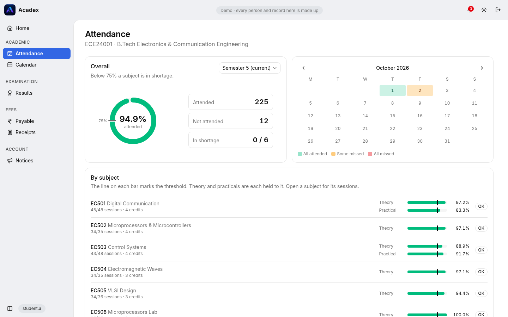
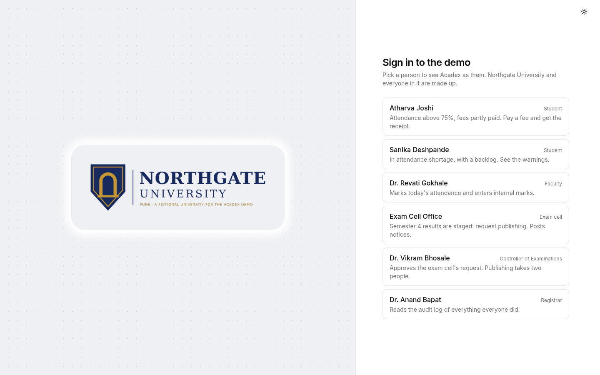
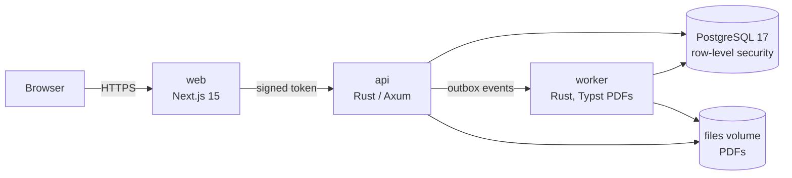

# Acadex demo

A runnable demo of **Acadex**, a cloud-native university ERP: attendance, results, fees and notices for a university's students and staff, built in Rust and Next.js on PostgreSQL.

It runs on your machine with one command, as **Northgate University**, a fictional university with 500 made-up students and staff. Sign in as any of them with one click; there's no account to create.



> This is a stripped-down version of the full product, which is built for Google Cloud. The demo keeps the core student journey and the parts of the architecture that matter most, and swaps the cloud services for small local stand-ins. See [What's in the demo](#whats-in-the-demo).

## Run it

You need **Docker** (with Compose) and **openssl**.

```bash
./setup.sh
docker compose up --build
```

Then open **http://localhost:3000**. The first build compiles the Rust services and takes several minutes; later starts are quick.

`setup.sh` writes `.env` with secrets generated for your install: the key that signs demo sign-ins, the payment webhook secret and the key between the website and the API. Nothing secret is in the repository.

To start again from fresh demo data:

```bash
docker compose down -v && docker compose up --build
```

## A five-minute tour

Pick a person on the sign-in page. Each one shows a different part of the system:




| Sign in as | Try this |
|---|---|
| **Atharva Joshi**, student | *Attendance*: overall percentage and each subject against the 75% line. *Fees → Payable*: pay a fee through the test checkout, then find the receipt PDF under *Receipts*. |
| **Sanika Deshpande**, student | *Attendance*: a shortage, flagged in red. Request a correction for a session marked absent. |
| **Dr. Revati Gokhale**, faculty | *Attendance*: mark today's class, starting from the timetable. |
| **Exam Cell Office** | *Results*: semester 4 is staged. *Request publishing*. Post a notice under *Notices*. |
| **Dr. Vikram Bhosale**, Controller of Examinations | *Results*: *Approve and publish*. Publishing takes two people; the exam cell can't approve its own request. |
| **Dr. Anand Bapat**, Registrar | *Logs*: everything everyone just did, by whom and from where. |

After the results are published, sign in as Atharva again: semester 4's results and grade card are there.

## What's in the demo

**Kept:**
- **Attendance:** student summaries, a month calendar and each session; faculty marking from the timetable; correction requests and the head of department's decisions.
- **Results:** staged results, external and internal marks entry, two-person publishing and withdrawal, grade card PDFs.
- **Fees:** what's payable, payment through a test gateway that signs its webhooks like Razorpay, receipt PDFs, and reconciliation of payments whose webhook was lost.
- **Notices:** targeted notices, scheduling, read receipts, critical notices that must be acknowledged, and live updates.
- **Calendar**, and the **audit log** of every action.

**Left out:** the full product also has activities, exam forms and hall tickets, the accounts office, student support, profiles and documents, curriculum and timetable editing, promotion, MOOC credit transfer, administration, and a platform console for the vendor.

## How it works



- **The website** (Next.js, server-rendered) is the only thing the browser talks to. It keeps the session in an httpOnly cookie that page scripts can't read, and calls the API on the user's behalf.
- **The API** (Rust, Axum) checks every request against the role's permissions, and every query runs under **PostgreSQL row-level security** as the signed-in user, so even a bug in a query can't return another student's rows.
- **Background work** goes through a **transactional outbox**: a payment and the note "make its receipt" commit together, so one can't happen without the other. The worker turns the note into a PDF.
- **Every action** is written to a **hash-chained audit log**, which a scheduled job verifies.

### The full product, and what stands in for it here

| Full product (Google Cloud) | In this demo |
|---|---|
| Auth0 sign-in (password or Google), behind reCAPTCHA | A persona picker. The website signs a short-lived RS256 token with a key generated at setup; the API trusts only that key, with issuer, audience and algorithm pinned, exactly as it checks Auth0's tokens |
| Cloud Run: web, API and worker, scaling from zero | Docker Compose services |
| Cloud SQL for PostgreSQL | PostgreSQL 17 in a container |
| Pub/Sub, pushing events to the worker | The API posts the same push envelope straight to the worker |
| Cloud Storage | A shared Docker volume |
| Memorystore for Redis (cache, shared rate limits) | The API's in-process cache and per-instance limits |
| Cloud Scheduler and Cloud Run Jobs | The worker runs the scheduled jobs on a timer |
| Cloud KMS envelope encryption, ClamAV scanning, SMTP | Not needed by the parts in the demo |
| Razorpay | A test gateway built into the website |

The full design is in [docs/architecture.md](docs/architecture.md).

### Measured on the full product

- One API instance (1 vCPU, 512 MB) handled **3,000 requests a second** on the results-day mix, with every read under 150 ms ([docs/load-results.md](docs/load-results.md)).
- On Google Cloud it held **500 requests a second for two minutes** at about **10 ms** server response, and a new server started in about **1.8 seconds** ([docs/cloud-load-test.md](docs/cloud-load-test.md)).

## Security in the demo

Still in place from the full product:
- Row-level security on every query.
- Role permissions on every request.
- A content security policy with per-request nonces.
- CSRF protection: an Origin check plus a double-submit token.
- Rate limits and load shedding in the API.
- Caller addresses that can't be forged with headers.
- Signed, replay-protected payment webhooks.
- The tamper-evident audit log.

The demo sign-in is only safe because everything here is made up. Anyone who can reach the site can sign in as anyone. Don't put real data in it or expose it to the internet.

## Repository layout

```
backend/    Rust workspace
  crates/acadex-api       HTTP API (Axum)
  crates/acadex-worker    events and scheduled jobs; PDFs with Typst
  crates/acadex-db        migrations, row-level security, demo seed data
  crates/acadex-auth      token verification, roles and permissions
  crates/acadex-cloud     the local stand-ins (events, file storage), the payment gateway client
  crates/acadex-telemetry tracing (OpenTelemetry, off unless configured)
frontend/   Next.js 15, Tailwind CSS v4, shadcn/ui
infra/      the database's roles
docs/       design and load-test results of the full product
```

## Development

With [just](https://github.com/casey/just), Rust (the toolchain is pinned in `backend/rust-toolchain.toml`) and Node.js 24 with pnpm:

```bash
just test-backend    # cargo fmt, clippy and the tests, against a throwaway Postgres
just test-frontend   # ESLint and TypeScript
```

`just` lists the other recipes (start, stop, reset, logs).

## License

[MIT](LICENSE)
