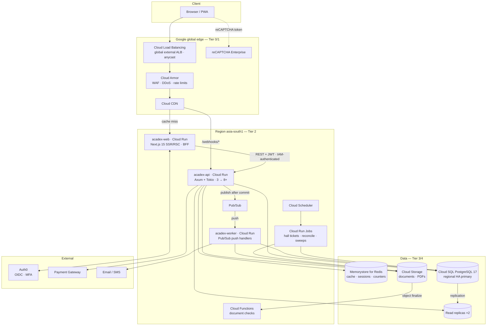
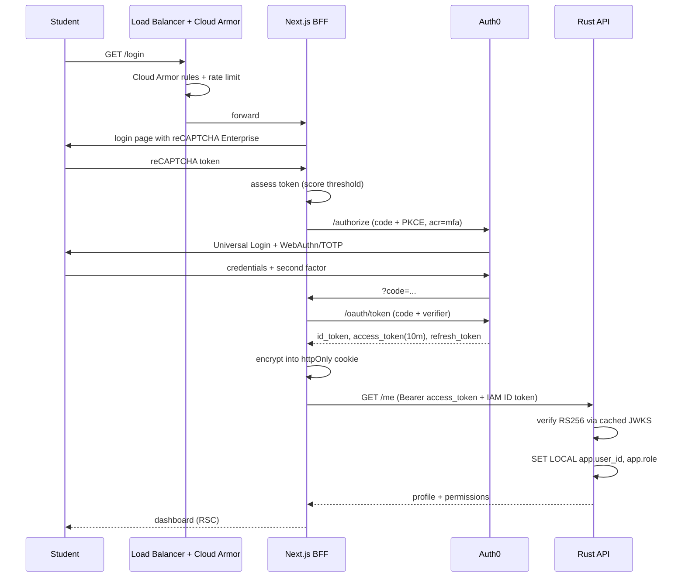

# Acadex — System Architecture

> **About this document.** This is the design of the full Acadex product. The demo in this repository implements part of it: the core student journey, run locally with stand-ins for the cloud services (see the [README](../README.md)). Mentions of `plan.md` and `demo-plan.md` refer to planning documents that aren't published here.

**Project:** Acadex — College ERP
**Stack:** Rust (Axum/Tokio) · Next.js 15 + shadcn/ui · PostgreSQL 17 · Auth0
**Platform:** Google Cloud · `asia-south1` (Mumbai)
**Status:** Design v3.0 — aligned with `Acadex-Cloud-Computing.pptx`
**Companion documents:** plan.md (production plan) · demo-plan.md (scaled-down demo build)

---

## Table of Contents

1. [Scope & Design Assumptions](#1-scope--design-assumptions)
2. [Capacity Model & Sizing](#2-capacity-model--sizing)
3. [System Topology](#3-system-topology)
4. [Technology Stack](#4-technology-stack)
5. [Backend Architecture (Rust)](#5-backend-architecture-rust)
6. [Data Architecture](#6-data-architecture)
7. [Authentication & Authorization](#7-authentication--authorization)
8. [Frontend Architecture](#8-frontend-architecture)
9. [Domain Module Specifications](#9-domain-module-specifications)
10. [Caching Strategy](#10-caching-strategy)
11. [Background Workers & Async Processing](#11-background-workers--async-processing)
12. [Observability & SLOs](#12-observability--slos)
13. [Security Controls](#13-security-controls)
14. [Deployment & Infrastructure](#14-deployment--infrastructure)
15. [Testing Strategy](#15-testing-strategy)
16. [Risk Register & Open Questions](#16-risk-register--open-questions)

---

## 1. Scope & Design Assumptions

### 1.1 What Acadex is

A multi-tenant college ERP serving students, faculty, exam cell, accounts, and administration. Eight functional areas: Academic, Activities, Examination, Fees, Profile, Notices, Support, Logs.

### 1.2 Assumptions

| # | Assumption | Rationale |
|---|---|---|
| A1 | Capacity target is **10,000 req/s at origin** and **50,000 req/s at the edge**, derived from a 50,000-student institution. | See §2. Derived from the results-day peak plus headroom; the scaling rule in §2.4 re-derives it for a different enrolment. |
| A2 | Single institution per deployment; `institution_id` present on all root entities for future multi-college. | Avoids a schema migration later; costs one indexed column now. |
| A3 | Payments are handled by an external PCI-DSS-compliant gateway (Razorpay / BillDesk / PayU). Acadex never touches card data. | Fees requires a redirect to a payment portal. |
| A4 | Academic year, semester numbering, and grading rules are configuration, not code. | Universities change these; hardcoding them causes annual emergency releases. |
| A5 | Google is available as an **optional SSO connection** in Auth0. | Many colleges issue Workspace accounts; SSO reduces password surface. Not required — email/password + MFA works standalone. |

| A6 | Hosted on **Google Cloud in `asia-south1` (Mumbai)**, with backups in `asia-south2` (Delhi). | Student personal data stays in India under the DPDP Act 2023. Managed services keep the operations load small enough for a college team. |

### 1.3 Non-goals for v1

Payroll · HR · library circulation · hostel & mess · transport · alumni · placements · timetable *generation* (the timetable itself is in scope: entered by hand and clash-checked, §9.1) · native mobile apps (the PWA covers mobile) · offline-first sync.

---

## 2. Capacity Model & Sizing

### 2.1 Inputs

| Parameter | Value |
|---|---|
| Enrolled students | 50,000 |
| Faculty + staff | 1,600 |
| Daily active students | 60% → 30,000 |
| Sessions per active user per day | 2 |
| Page views per session | 8 |
| API calls per page view | 3 (RSC prefetch + client queries) |
| Peak-hour share of daily volume | 25% |
| Intra-hour burst factor | 3× |

### 2.2 Derived load

| Scenario | Model | Edge rps | Origin API rps |
|---|---|---|---|
| **Normal weekday peak** | 30k × 2 × 8 × 3 = 1.44M req/day → 360k in the peak hour → 100 rps mean × 3 burst | ~750 | ~300 |
| **Deadline day** (exam form, fees) | 15k submissions in the final hour; write-heavy, low rps, high value | ~4,000 | ~1,200 |
| **Results day** | 21,000 students in the first 5 min × 15 calls = 315k / 300s = 1,050 rps mean, × 3.5 announcement burst | ~13,000 | ~3,700 |
| **Results day + refresh storm** | × 2 retry amplification when the page feels slow | ~19,000 | ~7,500 |

Results day is the design event. Everything else is an order of magnitude below it.

### 2.3 Targets

| Tier | Origin API | Edge | Meaning |
|---|---|---|---|
| **Design target** | **10,000 rps** | **50,000 rps** | All SLOs hold. ~1.3× the worst modelled origin case, ~2.6× at edge — covers enrolment growth, estimation error, and running with one zone down. |
| **Tested ceiling** | 20,000 rps | 100,000 rps | Load-tested twice a release. Must degrade gracefully (§2.8), not collapse. |
| **Provisioned baseline** | 3 Cloud Run min instances ≈ 11,000 rps | — | Autoscale on concurrency to 8+ instances ≈ 30,000 rps |

**The binding constraint is availability, not throughput.** Three instances is the minimum sane HA deployment, and it already exceeds normal-day load by 35×. Sizing is driven by "survive a zone failure during results publication", not by raw request volume. Cloud Run is regional and spreads instances across zones itself; a minimum of 3 keeps warm capacity if one zone is lost. The ~3,750 rps per instance figure is an estimate until the Phase 0 throughput spike measures it (plan.md §11.3). **Measured locally (demo Phase 3):** one 1-vCPU, 512 MiB instance sustains 3,000 rps on the results-day mix with every read under its p99 budget and saturates at about 4,500–5,000 ([docs/load-results.md](load-results.md)), which brackets the estimate; it is re-measured on Cloud Run in demo Phase 5.

### 2.4 Scaling rule

Re-derive for any enrolment:

```
peak origin rps   ≈ 0.15 × enrolled students
design target rps ≈ 0.20 × enrolled students
edge target rps   ≈ 5 × design target
```

| Institution | Students | Design target (origin) |
|---|---|---|
| Single college | 5,000 | 1,000 rps |
| Large college | 20,000 | 4,000 rps |
| **This deployment** | **50,000** | **10,000 rps** |
| University system | 200,000 | 40,000 rps |

### 2.5 Tier budget

| Tier | Component | Capacity | What it serves | Scale-out |
|---|---|---|---|---|
| 0 | Cloud CDN + Cloud Armor | Global, Google-managed | Static assets, public cached GETs, WAF, DDoS, rate limits | Automatic |
| 1 | Cloud CDN with a user-scoped cache key | Global, Google-managed | Personalised-but-cacheable reads (30s TTL) — *pending the Phase 1 spike; falls back to Tier 3 (§2.6)* | Automatic |
| 2 | Rust/Axum on Cloud Run (`acadex-api`) | ~3,750 rps per instance (estimate); 3 instances ≈ 11k | All mutations, uncacheable reads, auth-scoped queries | Add instances linearly, 3 → 8+ |
| 3 | Memorystore for Redis, Standard tier | Far above origin need | Hot rows, per-user summaries, sessions, rate counters | Larger node, then Memorystore cluster |
| 4 | Cloud SQL for PostgreSQL, regional HA + 2 read replicas | ~25k qps reads, ~4k qps writes (estimate) | System of record — partitioned, RLS | Add read replicas, then shard on `program_id` |

**Scale-out:** every tier is horizontally scalable without redesign. Origin capacity is linear in Cloud Run instance count. Cloud SQL scales by adding read replicas, and beyond that by sharding on `program_id` — which is already the top-level partition key (§6.3), so sharding becomes a routing change rather than a data migration. Growth is a provisioning decision, not an architecture decision.

### 2.6 Traffic mix and cache ratios

These ratios keep origin load an order of magnitude below edge load. They are measured in staging and alerted on in production — a drop in cache hit ratio is an early warning, not a post-incident finding.

| Traffic class | Share | Served by | Origin load @50k edge rps |
|---|---|---|---|
| Static assets (JS/CSS/fonts/logo) | 62% | Tier 0 Cloud CDN, immutable, 1yr TTL | 0 |
| Public cached (notices, calendar, subject lists) | 18% | Tier 0 Cloud CDN, 60s TTL + stale-while-revalidate | ~0 |
| Per-user cacheable (attendance %, results, fees) | 14% | Tier 1 Cloud CDN (user-scoped key) + Tier 3 Memorystore, 30s TTL | ~210 rps |
| Uncacheable reads (search, support threads, logs) | 4% | Tier 2 Cloud Run → read replicas | 2,000 rps |
| Mutations (pay, edit, ticket, exam form) | 2% | Tier 2 Cloud Run → primary | 1,000 rps |

**Open item — per-user caching at the edge.** The ~210 rps figure assumes Cloud CDN caches per-user responses, which needs a cache key containing a stable per-user value and a guarantee that one user's entry is never served to another. If the Phase 1 spike rules this out, the class is served from Memorystore at origin instead: still cheap (sub-millisecond reads), but ~7,000 more rps reach Cloud Run, so the origin target and instance ceiling are re-derived (plan.md risk 11).

### 2.7 Hard engineering rules

Enforced in CI, not aspirationally. These are what make the numbers above hold as the codebase grows:

- **R1 — No N+1 across a request boundary.** Every endpoint issues a bounded, statically known number of queries. Asserted via `tracing` span counts in integration tests.
- **R2 — Every list endpoint is keyset-paginated.** `OFFSET` is banned; CI greps for it in `crates/acadex-db`.
- **R3 — Every GET declares its cache policy** via a typed `CachePolicy` on the response. Missing policy = compile error.
- **R4 — Every mutation is idempotent** under an `Idempotency-Key` header, backed by `ops.idempotency_keys`.
- **R5 — p99 latency budget per endpoint is declared in code** and asserted in the load suite; a regression fails the pipeline.
- **R6 — Connection pool is never the bottleneck:** app-side `sqlx` pool ≤ 20 per instance, and Cloud Run max instances × pool size is kept below Cloud SQL `max_connections` (enforced in Terraform); hard statement timeout 3s.

### 2.8 Load-shedding and backpressure

At saturation the system degrades predictably rather than collapsing:

1. `tower::load_shed` + `ConcurrencyLimit` per route class — `503 Retry-After` above declared inflight limits.
2. Priority classes: mutations and auth > reads > exports/PDF > search. Search and export shed first.
3. Cloud Armor rate limiting (keyed on IP and session cookie): 100 req/min/user reads, 20/min mutations, 5/min auth attempts.
4. Circuit breakers around Auth0 and the payment gateway (`failsafe-rs`), falling back to queued processing.
5. Read replicas serve stale-tolerant queries; if replica lag > 5s the router falls back to primary for correctness-critical reads only (marks, fees).

---

## 3. System Topology



### 3.1 Why Next.js talks to Rust and the browser never does

The browser holds **only** an httpOnly, `SameSite=Lax`, encrypted session cookie. Next.js route handlers act as a **Backend-for-Frontend**: they exchange the session for an Auth0 access token server-side and call the Rust API with `Authorization: Bearer`. Consequences:

- No JWT in `localStorage` → XSS cannot exfiltrate a credential.
- Token refresh and rotation are invisible to the client.
- `acadex-api` is not publicly reachable. Its Cloud Run ingress is set to *internal and Cloud Load Balancing*, and the load balancer routes only `/webhooks/*` to it (for the payment gateway, behind Cloud Armor). Everything else comes from `acadex-web` over Direct VPC egress, which must present a Google-signed ID token for its own service account (`roles/run.invoker`) as well as the user's Auth0 token — two independent checks, no shared secret.
- CSRF is handled by `SameSite` + an origin check + a double-submit token on mutations.

---

## 4. Technology Stack

### 4.1 Backend (Rust)

| Concern | Choice | Why |
|---|---|---|
| Runtime | `tokio` (multi-thread) | Standard, work-stealing scheduler |
| HTTP | `axum` 0.8 + `tower` / `tower-http` | Typed extractors; tower gives timeout/load-shed/trace as composable layers |
| DB | `sqlx` 0.8 (Postgres, compile-time checked) | Queries verified against a live schema at build time — no ORM impedance |
| Pooling | app `sqlx::PgPool` per instance (≤20), separate primary and replica pools | Total connections bounded by Cloud Run max instances × pool size (rule R6) |
| Cache | `fred` (Memorystore for Redis) + `moka` (in-process L1) | Two-level cache; moka absorbs hot keys without a network hop |
| Auth | `jsonwebtoken` + `jwks-client` (RS256, cached JWKS) | Stateless verification; no Auth0 round-trip per request |
| Validation | `validator` + `garde` | Declarative, derives from the DTO |
| Errors | `thiserror` (lib) / typed `ApiError` (api) | Every error maps to an RFC 9457 Problem Details response |
| Telemetry | `tracing` + `tracing-opentelemetry` + `metrics`, OTLP export | Traces to Cloud Trace, metrics to Cloud Monitoring; trace IDs propagate to the frontend |
| API docs | `utoipa` + `utoipa-swagger-ui` | OpenAPI 3.1 generated from handlers → TS client via `openapi-typescript` |
| Migrations | `sqlx::migrate!` with a directory tree (§6.5) | Embedded in the binary; run by a Cloud Run Job before traffic shifts |
| PDF | `typst` (embedded as a library) | Rust-native, fast, template-driven — hall tickets and receipts |
| Jobs | Pub/Sub push to `acadex-worker` + transactional outbox; Cloud Run Jobs for batch | Retries and dead-lettering handled by Pub/Sub; no queue to operate |
| Google Cloud | Google Cloud Rust client libraries (Pub/Sub, Storage, Secret Manager, KMS) | Authenticated by the service's attached service account — no key files |
| HTTP client | `reqwest` + `failsafe` circuit breakers | Auth0 / payments |
| Testing | `sqlx::test` + `testcontainers` + `wiremock` + Pub/Sub and Cloud Storage emulators | Real Postgres per test, mocked externals |

### 4.2 Frontend

| Concern | Choice |
|---|---|
| Framework | Next.js 15 (App Router, RSC) + React 19 + TypeScript strict |
| UI | shadcn/ui + Tailwind CSS v4 + Radix primitives |
| Server state | TanStack Query v5 (with RSC hydration) |
| Client state | Zustand (sidebar collapse, semester selectors, theme) |
| Forms | react-hook-form + zod (schemas shared with the generated API types) |
| Tables | TanStack Table v8 (Course Status, Fees, Receipts, Logs) |
| Charts | Recharts (attendance trends, marks distribution) |
| Auth | `@auth0/nextjs-auth0` v4 |
| Icons | `lucide-react` |
| Dates | `date-fns` + `@internationalized/date` (calendar views) |
| Theming | `next-themes`, light/dark, CSS custom properties |

### 4.3 Infrastructure

Google Cloud, `asia-south1`: Cloud Run · Cloud Run Jobs · Cloud Functions · Pub/Sub · Cloud Scheduler · Cloud SQL for PostgreSQL 17 (`pg_trgm`, `pgcrypto`, `pg_partman` where supported) · Memorystore for Redis · Cloud Storage · Cloud Load Balancing · Cloud CDN · Cloud Armor · reCAPTCHA Enterprise · Cloud IAM · Secret Manager · Cloud KMS · Cloud Monitoring · Cloud Logging · Cloud Trace · Cloud Build · Artifact Registry · Binary Authorization · Terraform. Identity: Auth0 (external).

---

## 5. Backend Architecture (Rust)

### 5.1 Workspace layout

```
backend/
├── Cargo.toml                      # workspace manifest
├── crates/
│   ├── acadex-api/                 # [bin] Axum HTTP server
│   │   ├── src/
│   │   │   ├── main.rs
│   │   │   ├── router.rs           # route table, per-route tower layers
│   │   │   ├── middleware/         # auth, tenant, rate-limit, idempotency, trace
│   │   │   ├── extractors/         # AuthUser, Semester, Pagination, IdempotencyKey
│   │   │   ├── response.rs         # CachePolicy-carrying response types (rule R3)
│   │   │   ├── error.rs            # ApiError -> RFC 9457
│   │   │   └── routes/
│   │   │       ├── academic/       # subjects, mooc, calendar, attendance,
│   │   │       │                   #   course_status
│   │   │       ├── activities/     # general, seminar, workshop, industrial_visit
│   │   │       ├── examination/    # forms, hall_ticket, results
│   │   │       ├── fees/           # payable, receipts, webhooks
│   │   │       ├── profile/        # sections, documents
│   │   │       ├── notices/
│   │   │       ├── support/        # tickets, messages
│   │   │       ├── logs/           # audit read API
│   │   │       └── search/         # universal search
│   │   └── tests/                  # integration tests (testcontainers)
│   ├── acadex-worker/              # [bin] Pub/Sub push handlers + Cloud Run Job entrypoints
│   ├── acadex-core/                # domain types, value objects, policy traits
│   ├── acadex-db/                  # repositories, migrations/, RLS session helpers
│   ├── acadex-auth/                # JWKS, claims, RBAC, permission matrix
│   ├── acadex-cache/               # L1 moka + L2 redis, typed keys, invalidation
│   ├── acadex-pdf/                 # Typst templates: hall ticket, receipt, report
│   ├── acadex-payments/            # gateway adapters, signature verify, webhooks
│   ├── acadex-search/              # Postgres full-text + pg_trgm, ACL-scoped query
│   ├── acadex-notify/              # email/SMS/in-app fan-out
│   └── acadex-telemetry/           # tracing/otel → Cloud Trace + Cloud Monitoring
```

### 5.2 Layering

```
  HTTP (axum handler)         ← DTOs, validation, HTTP semantics, CachePolicy
        ↓
  Service (acadex-core)       ← business rules, authorisation decisions, transactions
        ↓
  Repository (acadex-db)      ← sqlx queries, mapping, keyset pagination
        ↓
  PostgreSQL (+ RLS)          ← final authorisation backstop
```

Handlers never touch `sqlx`. Services never touch `axum`. This keeps services unit-testable without an HTTP stack and lets the same service power both the API and the worker binary.

### 5.3 Middleware stack (outermost → innermost)

```rust
Router::new()
    .merge(routes)
    .layer(SetSensitiveHeadersLayer::new([AUTHORIZATION, COOKIE]))
    .layer(TraceLayer::new_for_http().make_span_with(request_span))   // trace id
    .layer(CatchPanicLayer::custom(panic_to_500))
    .layer(TimeoutLayer::new(Duration::from_secs(10)))
    .layer(RequestBodyLimitLayer::new(2 * 1024 * 1024))
    .layer(CorsLayer::very_permissive_for_origin(&cfg.frontend_origin))
    // origin protection: Cloud Run ingress + IAM invoker, enforced before the request arrives (§3.1)
    .layer(from_fn(rate_limit))                  // Redis token bucket, per user+IP
    .layer(from_fn(authenticate))                // JWT -> AuthUser
    .layer(from_fn(bind_rls_session))            // SET LOCAL app.user_id / app.role
    .layer(from_fn(idempotency))                 // R4
    .layer(LoadShedLayer::new())                 // §2.8
    .layer(ConcurrencyLimitLayer::new(cfg.max_inflight))
```

### 5.4 Error model

Every error surfaces as RFC 9457 Problem Details, with a stable `type` URI the frontend switches on:

```json
{
  "type": "https://acadex.edu/errors/exam-form-window-closed",
  "title": "Examination form window has closed",
  "status": 409,
  "detail": "The regular examination form window for Semester 5 closed on 2026-08-01.",
  "instance": "/examination/forms",
  "trace_id": "4bf92f3577b34da6a3ce929d0e0e4736",
  "extensions": { "window_closed_at": "2026-08-01T18:30:00Z", "next_window": "backlog" }
}
```

`trace_id` is echoed in the UI's error toast, so a support ticket carries the exact trace to Cloud Trace.

---

## 6. Data Architecture

### 6.1 Organising principle

One PostgreSQL database, organised along three independent axes. Each axis solves a different problem, and together they give the navigational structure of a directory tree with the query-planner benefits of native partitioning:

| Axis | Mechanism | Problem it solves |
|---|---|---|
| **Domain** — Academic, Fees, Exams, Support … | **Schemas** (`academic`, `fees`, `exams`, …) | Namespacing, per-domain grants, ownership by team |
| **Program** — BTech-ECE, BTech-CSE … | **`PARTITION BY LIST (program_id)`** | Partition pruning: an ECE query never scans CSE rows |
| **Year** — SY, TY … | **`PARTITION BY RANGE (academic_year)`** sub-partition | Archival, per-year vacuum, drop-old-year in O(1) |
| **Source files** | **Migration + schema directory tree** (§6.5) | The human-manageable layout maintainers actually edit |

So `academic.attendance_btech_ece_2026` is a real, independently indexed, independently vacuumable, independently archivable physical table — reached through one logical `academic.attendance` that keeps joins, foreign keys, transactions, and cross-program reporting intact.

### 6.2 Schema map

| Schema | Contents |
|---|---|
| `org` | institutions, departments, programs, branches, batches, sections, academic_years, semesters, holidays |
| `identity` | users, roles, role_grants, user_identities (Auth0 sub ↔ user), mfa_enrollments, sessions, consent |
| `people` | students, faculty, staff, guardians, enrollments (student↔batch↔semester) |
| `profile` | personal_info, parent_info, contact_info, education_info, documents, profile_edit_requests |
| `academic` | subjects, curricula, curriculum_subjects, subject_offerings, faculty_assignments, mooc_courses, mooc_enrollments, academic_calendar, calendar_events, attendance, attendance_summary |
| `activities` | activity_types, activities, seminars, workshops, industrial_visits, participations, activity_attachments |
| `exams` | exam_sessions, exam_forms, exam_form_subjects, hall_tickets, seating, internal_components, internal_marks, external_marks, results, result_publications, revaluation_requests, course_status_mv |
| `fees` | fee_structures, fee_heads, student_ledger, invoices, invoice_lines, concessions, payments, payment_attempts, receipts, refunds |
| `comms` | notices, notice_targets, notice_reads, notifications, notification_prefs, delivery_log |
| `support` | ticket_categories, tickets, ticket_messages, ticket_attachments, ticket_assignments, sla_policies |
| `audit` | action_log (hash-chained, partitioned), auth_events, data_access_log |
| `ops` | outbox, jobs, idempotency_keys, feature_flags, config, migrations_meta |

### 6.3 Partitioning — worked example

Attendance is the highest-volume table (50k students × 6 sessions/day × 200 days ≈ 60M rows/year). It carries both partition axes:

```sql
-- academic/tables/attendance.sql
CREATE TABLE academic.attendance (
    institution_id  smallint    NOT NULL,
    program_id      smallint    NOT NULL,       -- 11 = BTECH-ECE
    academic_year   smallint    NOT NULL,       -- 2026  (SY of batch 2024)
    student_id      uuid        NOT NULL,
    offering_id     uuid        NOT NULL,
    session_date    date        NOT NULL,
    slot            smallint    NOT NULL,
    status          academic.attendance_status NOT NULL,   -- present|absent|late|excused
    marked_by       uuid        NOT NULL,
    marked_at       timestamptz NOT NULL DEFAULT now(),
    remark          text,
    PRIMARY KEY (program_id, academic_year, student_id, offering_id, session_date, slot)
) PARTITION BY LIST (program_id);

-- ── program axis: BTech-ECE ─────────────────────────────────────────────────
CREATE TABLE academic.attendance_btech_ece
    PARTITION OF academic.attendance FOR VALUES IN (11)
    PARTITION BY RANGE (academic_year);

-- ── year axis: SY (2026-27) ─────────────────────────────────────────────────
CREATE TABLE academic.attendance_btech_ece_2026
    PARTITION OF academic.attendance_btech_ece
    FOR VALUES FROM (2026) TO (2027);

CREATE INDEX ON academic.attendance_btech_ece_2026 (student_id, offering_id);
CREATE INDEX ON academic.attendance_btech_ece_2026 (offering_id, session_date);
```

Partition creation is automated by `pg_partman` where the Cloud SQL version supports it, otherwise by the weekly `partition.maintain` Cloud Run Job, so a new program or academic year provisions itself.

**Payoff:** "my attendance this year" prunes to a single ~1.2M-row partition instead of scanning 300M rows. Archiving a graduated batch is `DETACH PARTITION` — instant, no `DELETE`, no bloat.

Tables partitioned this way: `academic.attendance`, `exams.internal_marks`, `exams.external_marks`, `comms.notifications`, `audit.action_log` (by month), `fees.student_ledger` (by academic_year).

Tables deliberately **not** partitioned: `people.students`, `academic.subjects`, `support.tickets` — under a few hundred thousand rows, where partitioning adds planning overhead and buys nothing.

### 6.4 Row-Level Security

RLS is the backstop for authorisation. Even if a service-layer check is forgotten, the database refuses to return another student's row.

```sql
ALTER TABLE academic.attendance ENABLE ROW LEVEL SECURITY;

CREATE POLICY student_reads_own ON academic.attendance
    FOR SELECT
    USING (
        current_setting('app.role', true) = 'student'
        AND student_id = current_setting('app.user_id', true)::uuid
    );

CREATE POLICY faculty_reads_assigned ON academic.attendance
    FOR SELECT
    USING (
        current_setting('app.role', true) IN ('faculty','hod')
        AND offering_id IN (
            SELECT offering_id FROM academic.faculty_assignments
            WHERE faculty_id = current_setting('app.user_id', true)::uuid
        )
    );
```

The `bind_rls_session` middleware issues `SET LOCAL app.user_id = $1; SET LOCAL app.role = $2;` at transaction start. `SET LOCAL` is transaction-scoped, so it is safe with pooled connections.

### 6.5 Migration & SQL file organisation

The source-file layout mirrors the schema map — this is the directory structure maintainers work in day to day:

```
backend/crates/acadex-db/
├── migrations/                       # sqlx::migrate! — strictly ordered, immutable
│   ├── 0001_extensions.sql
│   ├── 0002_schemas.sql
│   ├── 0010_org.sql
│   ├── 0020_identity.sql
│   ├── 0030_people.sql
│   ├── 0040_profile.sql
│   ├── 0050_academic_core.sql
│   ├── 0051_academic_attendance_partitions.sql
│   ├── 0060_activities.sql
│   ├── 0070_exams.sql
│   ├── 0080_fees.sql
│   ├── 0090_comms.sql
│   ├── 0100_support.sql
│   ├── 0110_audit.sql
│   ├── 0120_ops.sql
│   └── 0200_rls_policies.sql
├── schema/                           # readable, regenerated source of truth
│   ├── org/{tables,views,functions}/
│   ├── academic/
│   │   ├── tables/{subjects,attendance,offerings}.sql
│   │   ├── views/{attendance_pct,course_status}.sql
│   │   ├── functions/{recompute_attendance_summary}.sql
│   │   └── policies/attendance_rls.sql
│   ├── exams/ · fees/ · support/ · audit/ …
└── seeds/
    ├── reference/{states,districts,castes,doc_types}.sql
    └── programs/
        └── btech/
            ├── ece/{curriculum_sy.sql,subjects_sy.sql}
            └── cse/…
```

`schema/` is generated from a live database by `just db-dump-schema` after every migration and committed — it gives reviewers a readable diff of *what the schema is*, while `migrations/` records *how it got there*.

### 6.6 Read/write split

`acadex-db` exposes two pools — one to the Cloud SQL primary, one spread across the two read replicas. Repository methods are annotated:

```rust
#[read_replica]   fn attendance_summary(...) -> ...   // routed to replica
#[primary]        fn submit_exam_form(...) -> ...     // routed to primary
```

Anything inside a transaction that has written, or that reads data the same request just wrote, is pinned to primary. Replica lag (Cloud SQL's replica-lag metric, also checked by the app) gates the router at 5s.

### 6.7 Audit log — the Logs page

Append-only, hash-chained, monthly partitions, no `UPDATE`/`DELETE` grant to the application role:

```sql
CREATE TABLE audit.action_log (
    id            bigint GENERATED ALWAYS AS IDENTITY,
    occurred_at   timestamptz NOT NULL DEFAULT now(),
    actor_id      uuid,
    actor_role    text        NOT NULL,
    action        text        NOT NULL,     -- 'exam_form.submitted'
    resource_type text        NOT NULL,     -- 'exam_form'
    resource_id   text,
    outcome       text        NOT NULL,     -- success | denied | error
    ip            inet,
    user_agent    text,
    trace_id      text,
    metadata      jsonb       NOT NULL DEFAULT '{}',
    prev_hash     bytea,
    row_hash      bytea       NOT NULL,     -- sha256(prev_hash || canonical_row)
    PRIMARY KEY (occurred_at, id)
) PARTITION BY RANGE (occurred_at);
```

A nightly worker verifies the chain and alerts on any break. Writes go through the transactional outbox so an audit record can never be lost by a crash between the business write and the log write.

---

## 7. Authentication & Authorization

### 7.1 Layered controls

```
  1. Cloud Armor                         ← WAF preconfigured rules, DDoS, per-IP and
                                            per-session rate limits, before origin
  2. reCAPTCHA Enterprise                ← login, password reset, support ticket,
                                            exam form submit (score-based, invisible)
  3. Auth0 Universal Login               ← OIDC Authorization Code + PKCE
                                            (optional Google SSO connection)
  4. Auth0 MFA (mandatory)               ← WebAuthn/passkey preferred, TOTP fallback,
                                            SMS only as break-glass for staff
  5. Auth0 Attack Protection             ← breached-password detection, brute-force
                                            lockout, suspicious-IP throttling
  6. Adaptive MFA                        ← re-challenge on new device/impossible travel
  7. Step-up authentication              ← re-auth (acr_values) before: exam form
                                            submission, fee payment, profile edit,
                                            document download
  8. BFF session (Next.js)               ← httpOnly + Secure + SameSite=Lax, encrypted
  9. Cloud IAM service-to-service        ← acadex-web → acadex-api needs a Google-
                                            signed ID token (roles/run.invoker)
 10. RS256 JWT to Rust API               ← 10-min access token, rotating refresh
 11. RBAC in service layer               ← permission matrix, deny-by-default
 12. Postgres RLS                        ← final backstop (§6.4)
```

**As built (demo):** the controls marked *paid* in Auth0's catalogue are left out, so the demo doesn't rely on a free trial that can lapse (demo-plan.md D5, D6). These are mandatory MFA (4), Attack Protection beyond brute-force lockout (5), adaptive MFA (6) and step-up authentication (7). MFA is presented as the production setting. Cloud Armor (1) isn't in front of the demo either: it runs on Cloud Run's own URLs, with no global load balancer (demo-plan.md §2.2). Everything from 8 down is built.

### 7.2 Login sequence



**As built (demo):** Acadex has its own sign-in page instead of Universal Login, so sign-in looks like the rest of the product and carries the university's logo.
- **Email and password:** a Next.js server action checks reCAPTCHA (`POST /sign-in/check`, scored by the API) and exchanges the credentials with Auth0's token endpoint directly, using the password-realm grant on the `Username-Password-Authentication` connection. It passes the person's address in `auth0-forwarded-for` (the application has *Trust Token Endpoint IP Header* on), so Auth0's brute-force lockout counts the person, not the server.
- **Session:** the tokens go into the same encrypted, httpOnly session cookie as the redirect flow.
- **Google:** goes straight to Auth0's `/authorize` with `connection=google-oauth2` (code + PKCE, as drawn above).
- **Linking:** the first sign-in of an Auth0 identity links it to the Acadex user with the same verified email. Public sign-up is off; staff create logins from Acadex (§9.9).

### 7.3 Roles & permission matrix

| Role | Scope |
|---|---|
| `student` | Own records only. Read academic/exam/fees; write activities, exam forms, support tickets, profile edit requests. |
| `faculty` | Assigned offerings. Mark attendance, enter internal marks, view assigned students. |
| `hod` | Department-wide read; approve activities, faculty assignments, attendance corrections. |
| `exam_cell` | Exam sessions, forms, hall tickets, external marks, result publication. |
| `accounts` | Fee structures, ledgers, concessions, receipts, refunds. |
| `support_agent` | Ticket queue, assignments, internal notes. |
| `admin` | Institution config, user lifecycle, notices, audit read. |
| `super_admin` | Break-glass. All actions logged and alerted; requires hardware key. |
| `platform_admin` | The vendor's operator, not the university's: onboards the university (profile, administrators), runs operations (outbox, dead letters, audit chain). Reaches no university route or record; university roles can't see or change platform accounts. |

**As built (demo):** the registrar is the `admin` role. `platform_admin` is confined in the API itself, so it reaches only `/me`, `/sessions`, `/platform/…` and operations, whatever its permissions say. A database trigger stops university roles from creating or changing platform accounts, and another refuses a university account whose email is outside the university's domains (§9.10).

Permissions are `resource:action:scope` triples (`attendance:write:offering`, `results:publish:institution`) evaluated by a single `Policy` trait in `acadex-core`, so the same decision function is used by API, worker, and tests.

### 7.4 Token & session hygiene

- Access token TTL 10 min; refresh rotation with reuse detection (a replayed refresh revokes the family).
- JWKS cached 10 min in-process, with a forced refetch on unknown `kid` (rate-limited to 1/min).
- Logout hits Auth0 RP-initiated logout, clears the cookie, and revokes the refresh family.
- Sessions bound to a device fingerprint hash; mismatch forces re-auth.
- All auth events (`login.success`, `mfa.failed`, `token.reuse_detected`, …) land in `audit.auth_events` and are surfaced on the Logs page.

---

## 8. Frontend Architecture

### 8.1 Application shell

```
┌──────────────────────────────────────────────────────────────────────────────┐
│ ☰   [▣]  Acadex ERP        ┌──────── Search ─────────┐        🔔 3     ⏻    │  56px
└──────────────────────────────────────────────────────────────────────────────┘
┌──────────────┬───────────────────────────────────────────────────────────────┐
│ ACADEMIC     │                                                               │
│  ▤ Subjects  │                                                               │
│  ◎ MOOC      │                                                               │
│  ▦ Calendar  │                      page content                             │
│  ✓ Attendance│                        (RSC)                                  │
│  ≡ Course St.│                                                               │
│              │                                                               │
│ ACTIVITIES   │                                                               │
│  ◇ General   │                                                               │
│  ⌂ Seminar   │                                                               │
│  ⚒ Workshop  │                                                               │
│  ⛭ Ind.Visit │                                                               │
│              │                                                               │
│ EXAMINATION  │                                                               │
│  ▤ Form      │                                                               │
│  ▣ Hall Ticket│                                                              │
│  ★ Results   │                                                               │
│              │                                                               │
│ FEES         │                                                               │
│  ₹ Payable   │                                                               │
│  ⎙ Receipts  │                                                               │
│              │                                                               │
│ ACCOUNT      │                                                               │
│  ⚇ Profile   │                                                               │
│  ⚑ Notices   │                                                               │
│  ☏ Support   │                                                               │
│  ⏱ Logs      │                                                               │
└──────────────┴───────────────────────────────────────────────────────────────┘
   264px expanded
```

### 8.2 Topbar

Left → right, in a single `<header>` with `grid-template-columns: auto auto 1fr auto auto`:

| Slot | Component | Behaviour |
|---|---|---|
| 1 | Sidebar toggle | `lucide/Menu`. Toggles Zustand `sidebarCollapsed`, persisted to `localStorage`, mirrored to a cookie so SSR renders the correct width with no flash. |
| 2 | Logo + title | Square logo (`48×48`, `aspect-square rounded-md`), then "Acadex ERP" wordmark. Title hides below `sm`; logo never hides. |
| 3 | Universal search | Centred, `max-w-2xl`, `⌘K` / `/` opens a `cmdk` dialog. Debounced 200ms, grouped results (Subjects · Notices · Receipts · Tickets · People), keyboard-navigable, ACL-scoped server-side. |
| 4 | Notifications | Bell with unread-count badge. Popover with tabs (All / Unread), SSE live updates, mark-read on open, "View all" → `/notices`. |
| 5 | Logout | `lucide/LogOut`. Confirmation dialog, then `POST /auth/logout` → Auth0 RP-initiated logout. |

### 8.3 Sidebar

**Expanded (264px):** each section renders an uppercase, `text-xs`, `tracking-wider`, `text-muted-foreground` title, followed by its items as `icon + label` rows. Sections are **not** collapsible — every item is always reachable in one click.

**Collapsed (72px):** section titles are removed from the visual flow (kept for screen readers via `sr-only`), and each section boundary renders a `<Separator />` line divider instead. Items show icons only, centred, each wrapped in a shadcn `Tooltip` (`side="right"`) carrying the label.

```tsx
// components/layout/sidebar.tsx  (structure)
{NAV_SECTIONS.map((section, i) => (
  <div key={section.id}>
    {collapsed
      ? (i > 0 && <Separator className="my-2" />)
      : <h3 className="px-3 pt-4 pb-1 text-xs font-semibold uppercase
                       tracking-wider text-muted-foreground">{section.title}</h3>}
    {collapsed && <span className="sr-only">{section.title}</span>}

    <nav>
      {section.items.map(item => (
        <SidebarLink key={item.href} {...item} collapsed={collapsed} />
      ))}
    </nav>
  </div>
))}
```

Width is animated via a CSS custom property (`--sidebar-w`) on the shell grid, so the transition is a single compositor-friendly property change. Active route is matched by `startsWith` on the segment and styled with `bg-accent` + a 2px leading indicator. On viewports `< md` the sidebar becomes a shadcn `Sheet` overlay.

### 8.4 Routing

```
app/
├── (auth)/login · callback · logout
├── (dashboard)/
│   ├── layout.tsx                       # topbar + sidebar shell, RSC
│   ├── page.tsx                         # dashboard: attendance %, dues, notices,
│   │                                    #   upcoming exams
│   ├── academic/
│   │   ├── subjects/  mooc/  calendar/
│   │   ├── attendance/  course-status/
│   ├── activities/ general/ seminars/ workshops/ industrial-visits/
│   ├── examination/ form/ hall-ticket/ results/
│   ├── fees/ payable/ receipts/
│   ├── profile/  notices/  logs/
│   └── support/[[...ticketId]]/
└── api/                                 # BFF route handlers → Rust API
```

### 8.5 Data-fetching pattern

RSC fetches on the server for first paint; TanStack Query hydrates and owns subsequent client interaction (semester switches, filters, polling).

```tsx
// app/(dashboard)/academic/attendance/page.tsx
export default async function Page({ searchParams }) {
  const sem = Number((await searchParams).sem) ?? await getCurrentSemester();
  const qc = new QueryClient();
  await qc.prefetchQuery({
    queryKey: ['attendance', sem],
    queryFn: () => api.attendance.get({ semester: sem }),
  });
  return (
    <HydrationBoundary state={dehydrate(qc)}>
      <AttendanceView semester={sem} />
    </HydrationBoundary>
  );
}
```

Semester selectors write to the URL (`?sem=5`) so views are shareable and bookmarkable, defaulting to the current semester.

### 8.6 Shared component inventory

`SemesterSelect` · `DataTable` (TanStack, with sticky header, column visibility, CSV export) · `StatCard` · `PageHeader` · `EmptyState` · `ErrorState` (shows `trace_id`) · `ConfirmDialog` · `FileDropzone` · `StatusBadge` (pass/fail/pending) · `AttendanceCalendar` · `MarksTable` · `SectionCard` (profile sections with per-section edit) · `TicketList` / `TicketDetail` · `NoticeCard` · `Timeline`.

### 8.7 Performance & accessibility

- `acadex-web` runs on Cloud Run from Next.js standalone output; content-hashed static assets are served by Cloud CDN with a 1-year immutable TTL.
- Route-level code splitting; Recharts is `next/dynamic` with `ssr: false`.
- `next/font` self-hosted, `font-display: swap`, subset — no external font request (CSP-friendly).
- Targets: LCP < 1.8s, INP < 200ms, CLS < 0.05 on mid-range Android over 4G.
- WCAG 2.2 AA: visible focus rings, `aria-current="page"` on active nav, tooltips on every collapsed icon, tables with `<caption>` and scoped headers, colour never the sole status carrier (pass/fail also carries an icon + text).

---

## 9. Domain Module Specifications

### 9.1 Academic

| Page | Data | Key endpoints |
|---|---|---|
| **Subjects** | Semester dropdown (defaults to current). Cards/table: subject name, code, credits, type (theory/lab/elective), faculty names per subject. | `GET /academic/subjects?semester=` |
| **MOOC** | Catalogue (NPTEL/Coursera/SWAYAM), enrolment, credit-transfer request, certificate upload, approval status. | `GET /academic/mooc`, `POST /academic/mooc/{id}/enroll`, `POST /academic/mooc/{id}/certificate` |
| **Academic Calendar** | Month/agenda view. Event types: holiday, exam, deadline, event, class-suspension. iCal export. | `GET /academic/calendar?from=&to=` |
| **Attendance** | Overall % ring + per-subject bars with the shortage threshold marked (e.g. 75%); month calendar colour-coded per day; subject-wise breakdown with conducted/attended/%; drill-down to session list. | `GET /academic/attendance/summary?semester=`, `GET /academic/attendance/calendar?month=`, `GET /academic/attendance/subject/{offeringId}` |
| **Course Status** | Table of **all** subjects across all semesters, sorted by semester: subject code, name, credits, internal pass/fail, external pass/fail, overall status. Grouped-by-semester rendering with subtotals. | `GET /academic/course-status` |

Course Status is served from a materialised view refreshed on result publication, since it joins across every semester a student has taken:

```sql
CREATE MATERIALIZED VIEW exams.course_status_mv AS
SELECT e.student_id, cs.semester, s.code, s.name, s.credits,
       im.status AS internal_status,        -- pass | fail | pending
       em.status AS external_status,
       CASE WHEN im.status='pass' AND em.status='pass' THEN 'cleared'
            WHEN im.status='fail' OR  em.status='fail' THEN 'backlog'
            ELSE 'pending' END AS overall_status
FROM people.enrollments e
JOIN academic.curriculum_subjects cs USING (curriculum_id)
JOIN academic.subjects s ON s.id = cs.subject_id
LEFT JOIN exams.internal_marks im ON …
LEFT JOIN exams.external_marks em ON …;

CREATE UNIQUE INDEX ON exams.course_status_mv (student_id, semester, code);
-- REFRESH MATERIALIZED VIEW CONCURRENTLY on result publication
```

**As built (demo, F2):** Course Status is a plain query under row-level security rather than this materialized view. PostgreSQL can't apply RLS to a materialized view, so serving it safely would need a SECURITY DEFINER wrapper that re-implements each role's visibility rules; the RLS query reuses the existing policies, so a student still sees only published marks, and at demo scale it runs in milliseconds. The view is the production optimisation for 50,000 students, read through such a wrapper.

**As built (demo):** four more Academic pages, each change audited:
- **Curriculum** (`curriculum:manage`; HODs for their department's programs, administration for all): subjects per program and semester, each with its credits, type and elective group. It also sets the teacher of each subject per academic year. A subject is *retired* rather than deleted once anything refers to it.
- **Electives:** a semester's electives share a *group* (e.g. Professional Elective I), and each student chooses one subject per group from their Subjects page. Rosters, attendance and marks follow `academic.takes(student, subject)`: core subjects for everyone, electives only for those who chose them.
- **Timetable:**
  - Students see their class's week, teachers what they teach, and anyone else a class they pick.
  - HODs (their programs) and administration add and remove periods. A clash is refused: the same students, teacher or room twice in one period. Electives in one group may share a period.
  - Attendance marking starts from the teacher's periods for the day.
- **Promotion** (`promotion:manage`): at term end, each semester's students, with attendance shortages flagged. Those to hold back are ticked; one action moves the rest up a semester and graduates the final one, recorded in `academic.promotions`.
- **Attendance rules:** no marking on a calendar holiday or class suspension. After `attendance_lock_days` (a setting, default 7) a session is settled; changes then go through the HOD's correction requests.
- **Calendar:** events can be edited, and attendance follows the edit.

### 9.2 Activities

Four types — General, Seminar, Workshop, Industrial Visit — sharing one base table with type-specific attribute tables, so listings and approvals are uniform while the forms differ.

| Type | Type-specific fields |
|---|---|
| General | category, title, organiser, role, level (college/state/national/international), position/award |
| Seminar | topic, speaker, organisation, mode (online/offline), duration hours |
| Workshop | title, conducting body, from/to dates, hours, skills covered, certificate |
| Industrial Visit | company, location, industry sector, visit date, accompanying faculty, report |

Common to all: description, evidence attachments (Cloud Storage), points/credits, approval workflow (`draft → submitted → hod_review → approved | rejected`), and an **Add** action opening a type-specific dialog form. Faculty/HOD get a review queue.

### 9.3 Examination

**Form** — three types: Regular, Backlog, Re-evaluation/Re-total.
- Regular: auto-populates current-semester subjects; student confirms; eligibility gates on attendance % and fee dues.
- Backlog: lists `backlog`-status subjects from `course_status_mv`; multi-select; per-subject fee computed live.
- Re-evaluation/Re-total: only for published results within the appeal window; per-subject fee; reason field.
- All three: fee calculation → gateway redirect → confirmation → immutable `exam_forms` row + PDF acknowledgement. Step-up auth + reCAPTCHA Enterprise required.

**Hall Ticket** — Selector 1: semester. Selector 2: Regular / Backlog / Re-evaluation. Download button. Gated on: form submitted, fees cleared, attendance eligibility, exam-cell release flag. PDF is generated by `acadex-pdf` (Typst) with photo, roll no, subject-wise schedule, venue, seat, instructions, and a QR code resolving to `/verify/{ticket_id}` for invigilator verification. Pre-generated in bulk by the `hallticket.generate` Cloud Run Job before release, stored in Cloud Storage, and served via signed URLs.

**Results** — Selector 1: semester (defaults to current). Selector 2: Regular / Backlog / Re-evaluation (defaults to Regular).
- *Internal marks per subject:* X CCAs (continuous assessment) + Y LCAs (lab/course assessment) + midterm + total. X and Y are **configuration per subject offering**, not constants — the table renders columns dynamically from `exams.internal_components`.
- *External marks per subject:* result sheet — marks obtained, max, grade, grade point, pass/fail; with SGPA/CGPA, credits earned, and overall result. Download as PDF.
- Publication is a controlled event: exam cell stages results, a 4-eyes approval flips `result_publications.published_at`, which triggers MV refresh, cache purge, and notification fan-out.

**As built (demo):**
- **Exam sessions:** a session can be **cancelled** with a reason, after which it takes no new forms, schedule entries or seating; exam rooms can be edited or removed. The exam cell can find any registration and open a student's hall ticket.
- **Withdrawing published results:** this is two-person, like publishing. The exam cell requests withdrawal with a reason, the Controller of Examinations approves. The results are then unpublished and their grade cards removed, ready to correct and publish again; the withdrawal is kept in `exams.publication_withdrawals`. The requester can't approve their own request.
- **Grade cards:** staff can download any student's.

### 9.4 Fees

**Payable** — table with columns **Particulars · Receivable · Pending · Paid · Concession · Remarks**, a totals row, and a **Pay** button per row and for the full outstanding amount. Pay creates a `payment_attempts` row with an idempotency key, then redirects to the gateway. The gateway webhook (signature-verified, replay-protected) is the source of truth; the browser return URL is treated as advisory only — a payment is never confirmed from a redirect.

**Receipts** — table with columns **ID · Date · Remarks · Amount · Download**. Receipt PDFs are generated on payment confirmation by the worker, stored in Cloud Storage, and served via short-lived signed URLs. Receipt numbers come from a gapless per-financial-year sequence (`fees.receipt_seq`, allocated inside the confirming transaction) — auditors require no gaps.

The ledger is double-entry: every charge, concession, payment, and refund is an immutable `student_ledger` entry. "Pending" is always *derived* (`SUM(charges) - SUM(credits)`), never stored, so the balance cannot drift.

**As built (demo):** fee structure lines and MOOC courses can be edited or retired, so a mistake is corrected rather than worked around.

### 9.5 Profile

Sections: **Admission Details · Personal Info · Parent/Guardian Info · Contact Info · Education Info · Documents**.

Each section is a `SectionCard` with its own **Edit** button. Client-side state guarantees **only one section is editable at a time** — opening a second edit prompts to save or discard the first. Field-level rules:

- Some fields are student-editable directly (phone, correspondence address, emergency contact).
- Others (name, DOB, admission number, category, blood group) require an **edit request** that lands in `profile.profile_edit_requests` for registrar approval, with before/after diff and supporting-document upload.
- Documents: upload to Cloud Storage, checked by a Storage-triggered Cloud Function (magic-byte type check + ClamAV scan), typed (10th/12th marksheet, transfer certificate, Aadhaar, caste certificate, migration), with verification status per document.
- PII columns (Aadhaar, bank account) are encrypted at rest with envelope encryption (Cloud KMS data key + AES-256-GCM in the app), and masked in all list views and logs.

Students can remove their own documents while unverified; verified documents stay.

**As built (demo, F4):** the registrar is the `admin` role (no separate role). Document scanning is the worker's `document.uploaded` push subscription, fed by the uploads bucket's object-finalize notifications, rather than a separate Cloud Function; it runs ClamAV first, then the magic-byte check, and deletes failing files. Locally the storage emulator publishes the same notifications and ClamAV runs as a container; on Google Cloud ClamAV is its own Cloud Run service. Envelope encryption seals each value with a fresh AES-256-GCM data key, wrapped by a local key-encryption key (`PII_KEK_LOCAL`) until Phase 4 points it at Cloud KMS; the student id and field are bound in as associated data, so a sealed value can't be moved to another row.

### 9.6 Notices

Three severities: **General · Important · Critical**, each with a distinct badge, colour, and icon (never colour alone). Notices carry targeting (institution / program / batch / section / individual), publish and expiry timestamps, attachments, and read receipts. Critical notices trigger push + email and render an unread interstitial the student must acknowledge. Read state is per-user in `comms.notice_reads`.

**As built (demo):** a published notice can be **edited** (the change is audited) or **withdrawn**: it disappears for its audience at once, and the publisher keeps the record. A scheduled notice can be deleted before it goes out. The list pages through history.

### 9.7 Support

Classic two-pane layout:

```
┌───────────────────────┬──────────────────────────────────────────────┐
│  [+ New ticket]       │  #4821  Fee receipt not generated            │
│  🔍 filter  ▾ status  │  ┌────────────────────────────────────────┐  │
├───────────────────────┤  │ Status  Open      Priority  High       │  │
│ ● #4821 Fee receipt…  │  │ Category Fees     Assignee  A. Rao     │  │
│   Open · High · 2h    │  │ Created 12 Aug    SLA       4h left    │  │
├───────────────────────┤  └────────────────────────────────────────┘  │
│   #4790 Attendance…   │                                              │
│   Resolved · 3d       │  ── conversation ──────────────────────────  │
├───────────────────────┤  [student] Paid on 10 Aug, no receipt…       │
│   #4712 Hall ticket…  │  [agent]   Checking with accounts…           │
│   Closed · 8d         │                                              │
│                       │  ┌ reply ─────────────────────────┐ [Send]   │
└───────────────────────┴──────────────────────────────────────────────┘
```

Left: ticket list with status/priority/category filters and unread indicators. Right: threaded conversation plus a details panel (status, priority, category, assignee, SLA countdown, linked resource, attachments, internal notes visible only to agents). Ticket creation is protected by reCAPTCHA Enterprise. SLA timers and auto-escalation run as the `support.sla` job.

### 9.8 Logs

Administration only (`audit:read_all`; decided 3 Oct 2026, replacing a per-user view of one's own actions). Table of every user's actions: **Timestamp · Who · Action · Outcome · IP · Device**, with an expandable metadata drawer per row. Filters by date range, action type, outcome, role and name; keyset-paginated; CSV export (itself audited). Backed by `audit.action_log` (§6.7). Auth events (logins, sign-outs, refused sign-ins, and Auth0's failed passwords and lockouts) appear in the same stream, so administration can audit account access for anyone.

### 9.9 Administration

For `admin` (the registrar), and `super_admin` under break-glass audit:

| Page | What it does |
|---|---|
| **Users** | Create, edit, deactivate, change role. **Get sign-in link** creates the person's Auth0 login through the Management API and shows a one-time set-password link, so nothing is emailed to real university inboxes. **CSV import:** a dry run first, then all-or-nothing. |
| **Departments** | Departments and their HODs; programs (code, name, number of semesters), added and corrected here. A new program also gets its attendance partitions. |
| **Settings** | Academic year, attendance threshold and lock window, grading scale, internal components, support response targets (first response and resolution by priority). |
| **Profile requests** | Edit requests with before/after diff; document verification. |
| **Logs** | §9.8. |
| **Erasure requests** | DPDP erasure that keeps what academic-record retention requires. |

### 9.10 Platform

Acadex is sold to universities, so the vendor's operator (`platform_admin`) is an account apart from any university's, and sees none of its records.

| Page | What it does |
|---|---|
| **University** | The university's profile (name, short name, city, website, contact email); its administrators; the **email domains** its accounts must use, with a list of any existing accounts outside them; its **logo**, shown on the sign-in page; usage figures. |
| **Operations** | The outbox, dead letters with replay, and the audit-chain check. |

---

## 10. Caching Strategy

### 10.1 Layers

| Layer | Store | TTL | Contents |
|---|---|---|---|
| L0 Browser | HTTP cache + TanStack Query | 0–60s | Immutable assets (1y), query results |
| L1 Edge | Cloud CDN | 60s–1y (30s per-user) | Static, public notices, calendar, subject catalogue; per-user summaries if the user-scoped key is approved (§2.6) |
| L2 In-process | `moka` per instance | 5–30s | Hot config, JWKS, permission matrix, subject metadata |
| L3 Shared | Memorystore for Redis | 30s–1h | Per-user summaries, session data, rate counters, search results |
| L4 DB | Materialised views | on event | `course_status_mv`, attendance summaries, fee balances |

### 10.2 Key design and invalidation

Cache keys embed everything that can change the answer, including a per-user epoch that makes bulk invalidation O(1):

```
acadex:v1:{institution}:{user_epoch}:{user}:attendance:sum:{semester}
acadex:v1:{institution}:{global_epoch}:subjects:{program}:{semester}
```

Bumping `user_epoch` (on any write touching that student) or `global_epoch` (on schema/config change) invalidates entire families without scanning keys. Writes that change published data additionally issue a Cloud CDN invalidation by path prefix (`/notices/*`, `/results/sem5/*`). Invalidation is asynchronous and rate-limited, so short TTLs (60s public, 30s per-user) remain the primary freshness guarantee; invalidation only shortens the window.

**Stampede protection:** single-flight per key (`moka`'s `try_get_with` + a Redis lock), plus jittered TTLs and `stale-while-revalidate` so a mass refresh on results day cannot converge into a thundering herd on the primary.

---

## 11. Background Workers & Async Processing

`acadex-worker` is a separate binary sharing `acadex-core`, so business rules are identical to the API path. It runs as a Cloud Run service receiving Pub/Sub push deliveries; scheduled and batch work runs as Cloud Run Jobs from the same image.

### 11.1 Transactional outbox

Every state change that must produce an external effect writes an `ops.outbox` row **inside the same transaction** as the business write. After commit, the API publishes the row to Pub/Sub and marks it sent; a sweeper (`outbox.sweep`, every minute) publishes any row left unsent by a crash between commit and publish, selecting with `FOR UPDATE SKIP LOCKED`. This makes "the DB says paid but the receipt was never generated" structurally impossible, without a long-running poller.

### 11.2 Job catalogue

| Job | Trigger | Runs on | Notes |
|---|---|---|---|
| `attendance.rollup` | Pub/Sub on write + Cloud Scheduler hourly | worker / Cloud Run Job | Refresh `attendance_summary` |
| `results.publish` | Pub/Sub event | worker | MV refresh → cache purge → notification fan-out |
| `fees.reconcile` | Cloud Scheduler, every 5 min | Cloud Run Job | Reconcile gateway settlements against `payments` |
| `receipt.generate` | Pub/Sub event | worker | Typst → Cloud Storage → notify |
| `hallticket.generate` | Exam-cell release | Cloud Run Job (parallel tasks) | Bulk pre-generation before release |
| `notify.fanout` | Pub/Sub event | worker | Batched email/SMS/push/in-app; per-user preference honoured |
| `outbox.sweep` | Cloud Scheduler, every minute | Cloud Run Job | Publish rows left unsent (§11.1) |
| `audit.verify_chain` | Cloud Scheduler, nightly | Cloud Run Job | Hash-chain verification, alert on break |
| `partition.maintain` | Cloud Scheduler, weekly | Cloud Run Job | Create-ahead / detach-archive partitions |
| `document.scan` | Cloud Storage object finalize | Cloud Function | Type check + ClamAV scan of profile document uploads |
| `support.sla` | Cloud Scheduler, every minute | Cloud Run Job | SLA breach detection and auto-escalation |

### 11.3 Guarantees

At-least-once delivery with idempotent handlers; Pub/Sub retries with exponential backoff, a dead-letter topic after max attempts, and an admin replay UI; every job runs in a `tracing` span linked to the originating request's trace.

---

## 12. Observability & SLOs

### 12.1 Instrumentation

- **Traces:** OpenTelemetry across browser → Next.js → Rust → Postgres, exported to Cloud Trace. `trace_id` surfaced in error UI and attached to support tickets.
- **Metrics:** RED per route (rate, errors, duration) + USE per resource in Cloud Monitoring; Cloud SQL connections and replica lag, cache hit ratio (load balancer logs + app), outbox depth, Pub/Sub backlog and oldest-unacked age.
- **Logs:** structured JSON to Cloud Logging, PII-redacted at the `tracing` layer (a `#[sensitive]` field attribute strips values before they reach the sink).

- **Business dashboards:** payment success rate, result-publication progress, ticket SLA compliance, attendance marking coverage.

### 12.2 SLOs

| Service | SLI | Target |
|---|---|---|
| API availability | non-5xx / total | 99.9% monthly |
| Read latency | p99 | < 150ms |
| Write latency | p99 | < 400ms |
| Payment → receipt | p95 | < 60s |
| Search | p95 | < 200ms |
| Hall-ticket download | p95 | < 2s |
| Error budget | 43m/month | burn-rate alerts at 2% / 5% / 10% |

### 12.3 Alerting

Cloud Monitoring alert policies, defined in Terraform: multi-window burn-rate alerts on SLOs (not raw thresholds), plus hard alerts on: replica lag > 30s, outbox depth > 10k, any message in a Pub/Sub dead-letter topic, **edge cache hit ratio below 90%** (the early warning that origin sizing is about to be tested), audit hash-chain break, payment reconciliation mismatch, and any `super_admin` action.

---

## 13. Security Controls

| Domain | Controls |
|---|---|
| Transport | HTTPS only with Google-managed certificates on the load balancer; SSL policy with minimum TLS 1.2 (TLS 1.3 negotiated by default); HSTS preload; Cloud Run ingress limited to internal + load balancer, so origin accepts only edge traffic |
| Headers | Strict CSP with per-request nonces and `'strict-dynamic'` (no `unsafe-inline` for scripts; inline *style attributes* are allowed, since React renders them and they can't run code), `frame-ancestors 'none'`, COOP `same-origin` and CORP (COEP is left off: reCAPTCHA's cross-origin frame can't satisfy it), `Referrer-Policy: strict-origin-when-cross-origin`, `Permissions-Policy` denying camera/mic/geo, HSTS with preload on HTTPS |
| Input | Server-side zod/`validator` on every DTO; parameterised SQL only (sqlx compile-time checked — string-built SQL cannot compile); MIME + magic-byte sniffing on uploads |
| Output | React auto-escaping; no `dangerouslySetInnerHTML` outside a sanitised (DOMPurify) notice renderer |
| CSRF | `SameSite=Lax` session cookie + `Origin` check + double-submit token (a `SameSite=Strict` cookie copied into an `x-csrf-token` header) on every non-GET request, server actions included; sessions bound to the browser (HMAC of session id, user agent and languages) so a copied session cookie is signed out |
| Rate limiting | Layered: Cloud Armor (IP and session), Redis token bucket in Memorystore (user + route class), Auth0 (auth attempts) |
| Caller address | Never the caller's own `X-Forwarded-For` entries. The API takes the entry its own front end appended (`TRUSTED_PROXY_HOPS`; the socket peer when there is none). The web app forwards a browser's address in `x-acadex-client-ip` with a key the two share (`BFF_FORWARDING_KEY`, Secret Manager), which the API believes only with that key. Rate limits, audit records and Auth0's per-IP lockout all use this address (`client_addr.rs`) |
| Service identity | One service account per Cloud Run service and job, least-privilege roles; no service account keys anywhere (Workload Identity); Cloud SQL IAM database authentication with short-lived tokens instead of static passwords |
| Secrets | Secret Manager, mounted per service at runtime; no secrets in env files or images |
| Data at rest | Google default encryption, with customer-managed keys (Cloud KMS) on Cloud SQL and Cloud Storage; column-level envelope encryption for Aadhaar, bank details, health info |
| PII handling | Field-level access control, masking in lists/logs/exports, purpose-bound `data_access_log` for staff reads of student PII |
| Dependencies | `cargo-audit` + `cargo-deny` + `npm audit` in CI; SBOM (CycloneDX) per release; Dependabot |
| Supply chain | Pinned lockfiles; images built only by Cloud Build into Artifact Registry with vulnerability scanning; Binary Authorization admits only signed images to Cloud Run |
| Backups | Cloud SQL automated backups + point-in-time recovery (5-min RPO), backup copies in `asia-south2`, weekly **restore drill** (an untested backup is not a backup) |
| Incident response | Runbooks per alert; break-glass procedure with hardware key + dual approval + automatic post-hoc review |
| Compliance | India DPDP Act 2023: all data held in `asia-south1` with backups in `asia-south2`; consent records, purpose limitation, retention schedule, data-subject export/erasure workflow (erasure honours statutory academic-record retention) |

---

## 14. Deployment & Infrastructure

### 14.1 Environments

`local` (docker-compose: Postgres, Redis, fake-gcs-server, Pub/Sub emulator, Jaeger, Mailpit, wiremock-gateway) → `dev` → `staging` (production-shaped, anonymised data restore) → `production`. Each cloud environment is its own Google Cloud project in `asia-south1`, built from the same Terraform modules with different sizing:

| Component | `dev` | `staging` / `production` |
|---|---|---|
| `acadex-api` (Cloud Run) | min 0, max 3 | min 3, max 8+, CPU always allocated |
| `acadex-web` (Cloud Run) | min 0, max 3 | min 2, max 10 |
| `acadex-worker` (Cloud Run) | min 0 | min 1 |
| Cloud SQL | Enterprise, zonal, shared-core | Enterprise, regional HA + 2 read replicas |
| Memorystore | none (in-process cache only) | Standard tier |
| Edge | Load balancer + Cloud CDN + Cloud Armor | Same |

### 14.2 Pipeline (Cloud Build)

```
push → fmt + clippy -D warnings + eslint/tsc
     → unit tests (cargo nextest, vitest)
     → integration tests (testcontainers Postgres, Pub/Sub + Cloud Storage emulators)
     → sqlx prepare check (offline query metadata current)
     → migration up/down + drift check against schema/
     → cargo audit / deny / npm audit / SBOM
     → build images (multi-stage, distroless, non-root) → Artifact Registry + sign
     → terraform plan (fails on unexpected drift)
     → deploy staging → smoke + e2e (Playwright) → k6 load gate (R5)
     → manual approval → canary 5% → progressive rollout → full
```

### 14.3 Runtime

Cloud Run services scale on request concurrency, not CPU — concurrency tracks IO-bound load directly and reacts in seconds, which a five-minute results-day spike needs. Cloud Run is regional and spreads instances across zones; `acadex-api` keeps 3 minimum instances so a zone loss leaves warm capacity. Canary and progressive rollout use Cloud Run revision traffic splitting; rollback is shifting traffic back to the previous revision (< 1 min). Cloud SQL runs regional HA (synchronous standby in a second zone, automatic failover) with two asynchronous read replicas. Migrations run as a Cloud Run Job with an advisory lock before traffic shifts; the expand/contract pattern keeps every migration backward-compatible with the previous app version (enables zero-downtime and instant rollback). All infrastructure is Terraform; console changes are treated as drift.

---

## 15. Testing Strategy

| Level | Tooling | Coverage focus |
|---|---|---|
| Unit | `cargo nextest`, `vitest` | Domain rules: attendance %, SGPA/CGPA, fee balances, eligibility gates |
| Property | `proptest` | Ledger invariants (balance never drifts), grade boundaries, partition routing |
| Integration | `sqlx::test` + testcontainers | Repositories against real Postgres incl. RLS policies |
| Contract | `wiremock` + recorded gateway fixtures | Payment webhooks: signature, replay, out-of-order, duplicate |
| API | generated OpenAPI client | Every endpoint's auth matrix — each role × each endpoint asserted allow/deny |
| E2E | Playwright | Golden journeys: login+MFA, mark attendance, fill exam form, pay fee, download hall ticket, view results, raise ticket |
| Load | `k6` (distributed across Cloud Run Jobs in a separate project) + `oha` | Per-endpoint p99 budgets (R5); soak, spike (results-day simulation), and the staged ramp validating §2.3 targets |
| Security | OWASP ZAP baseline, `cargo-audit`, manual pentest pre-launch | Top 10 + IDOR sweep across every `/{id}` route |
| Chaos | Scripted fault injection in staging (`gcloud` + wiremock) | Forced Cloud SQL failover, Memorystore failover, replica loss, payment gateway timeout, Pub/Sub backlog |

**RLS test harness:** a fixture matrix asserts, for every table with RLS, that each role sees exactly the expected row set. This is the test that prevents the worst class of ERP bug — one student seeing another's marks.

---

## 16. Risk Register & Open Questions

### 16.1 Risks

| # | Risk | Impact | Mitigation |
|---|---|---|---|
| R1 | Results-day thundering herd | High | Staged publication by batch, Cloud CDN with short TTLs and path invalidation, stampede protection (§10.2), documented load-shed order, cache-hit-ratio alerting |
| R2 | Payment reconciliation mismatches | High | Webhook-as-truth, idempotency keys, 5-minute reconciliation job, daily settlement report, alerting |
| R3 | Auth0 as a single point of failure for all logins | High | Cached JWKS + long-lived sessions ride out short outages; break-glass local admin auth path, drilled |
| R4 | University marks format changes or is not machine-readable | High | Adapter layer + manual import fallback; resolve open question §16.2.2 early |
| R5 | Capacity model wrong because enrolment or usage differs from §2.1 | Medium | Inputs are explicit and re-derivable via §2.4; production telemetry validates the model in the first term and the target is revised on evidence |
| R6 | Partition explosion (programs × years) | Medium | `pg_partman` automation, detach-and-archive after graduation + statutory retention |
| R7 | PII exposure through exports/logs | High | Field-level masking, redacting log layer, purpose-bound access log, export approval for bulk |
| R8 | Scope creep from "ERP means everything" | Medium | Non-goals in §1.3; change-control per phase in plan.md |
| R9 | Rust hiring/ramp-up for maintenance | Medium | Conventional Axum patterns, no exotic abstractions, ADRs for every non-obvious choice |

| R10 | Cloud CDN cannot safely cache per-user responses, so the 14% per-user class reaches origin | Medium | Phase 1 spike; fall back to Memorystore at origin and re-derive the origin target (§2.6) |
| R11 | Cloud cost overrun (min instances, HA database, replicas, load tests) | Medium | Budget alerts per project; `dev` sized down; load tests in a separate project; monthly cost review |
| R12 | Single-region (`asia-south1`) outage | High | Accepted for v1 under DPDP residency; backup copies in `asia-south2`; documented manual regional restore |

### 16.2 Open questions for stakeholders

1. **Payment gateway** — which provider, and is settlement T+1 or T+2? Affects reconciliation windows.
2. **University vs. college marks authority** — are external marks entered in Acadex or imported from a university portal? If imported, we need the format and cadence.
3. **Attendance shortage rule** — the exact threshold, condonation policy, and whether it's per-subject or aggregate.
4. **Grading scheme** — absolute or relative? SGPA/CGPA formula, grace-mark rules, backlog attempt limits.
5. **Internal components** — is the CCA/LCA count uniform per program, or per subject offering? (Design assumes per-offering; confirm.)
6. **Enrolment figures** — confirm the 50,000-student input in §2.1, or supply the real number so the capacity target is re-derived via §2.4.
7. **Retention** — statutory retention for academic records, fee receipts, and audit logs in the applicable state/university regulations.
8. **Google Cloud ownership** — whose organisation and billing account hosts the projects (ideally the college's), and who holds Owner access. *(Data residency is decided: all data stays in India — `asia-south1`, backups in `asia-south2`.)*
9. **Legacy migration** — what system is being replaced, and how many years of historical data must be imported?
10. **Faculty/staff portal scope** — v1 assumes faculty use the same shell with role-gated pages; confirm no separate admin app is expected.
11. **Google SSO** — should Google be offered as a login connection (A5), or is email/password + MFA the only path?
12. **Cloud SQL edition** — Enterprise with regional HA (99.95% SLA, covers the 99.9% SLO at lower cost) or Enterprise Plus (99.99% SLA, near-zero-downtime maintenance, higher cost)? *Design assumes Enterprise.*

---

*Document version 3.0 · Companion: plan.md · demo-plan.md*
